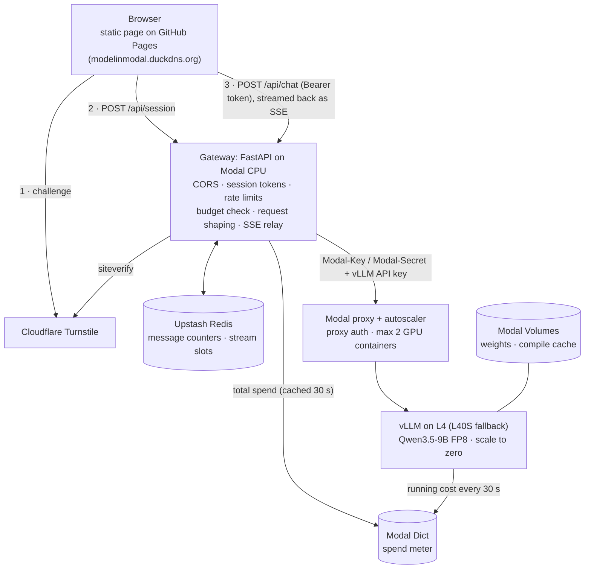

# model-in-modal

A public chat page where anyone can talk to **Qwen3.5-9B**, an open-weight LLM self-hosted with
**vLLM on Modal**. Visitors are rate-limited, GPUs scale to zero when idle, and a spend meter
switches the service off before Modal's $30/month free credit runs out — the page then shows
"out of credits until <reset date>".

**Live:** https://modelinmodal.duckdns.org

| | |
|---|---|
| Model | `Qwen/Qwen3.5-9B` (BF16 on a Volume, quantized to FP8 when vLLM loads it), thinking off, text only |
| Serving | vLLM 0.32.0, OpenAI-compatible API, FP8 KV cache, 8,192-token context |
| GPU | 1× **L4** per container, **L40S fallback** when no L4 is free; 0–2 containers |
| Front end | Plain HTML/CSS/JS on GitHub Pages; Cloudflare Turnstile |
| API | FastAPI gateway on a CPU Modal container; Upstash Redis for limits |
| Tests | 165 pytest tests, deployed end-to-end checks, real-browser checks, k6 load test |

## Architecture



The page, Turnstile and Redis live outside Modal, so the page can still say "offline" or "out of
credits" when Modal is stopped.

## How it works

**A visit.** The page calls `GET /api/status`. If the service is available it runs Turnstile and
exchanges the token at `POST /api/session` for a signed session token (HMAC-SHA256, 24 h), kept in
`sessionStorage` — no cookies, because the page and the API are on different domains. Creating a
session also sends one wake-up ping to vLLM, so a GPU starts booting while the visitor types.

**A message.** `POST /api/chat` runs its checks in order: session token (401) → budget (503
`credits_exhausted` + `resets_at`) → per-session and per-IP limits (429 + `retry_after`) → global
stream cap (503 `busy`) → request shaping → forward to vLLM and stream. While a GPU is still booting
the gateway answers 503 `warming_up` without touching Redis or the GPU, and the page shows "Waking up
the model (m:ss)…" and retries on its own. Messages are refunded when the service, not the visitor,
fails (warming up, busy, upstream error).

**Request shaping.** The browser's body is never forwarded. The gateway keeps only role + text of the
last 10 user/assistant messages, caps input at 4,000 characters per message and 12,000 in total, and
sets the system prompt, `max_tokens` 512, sampling and `enable_thinking: false` itself.

**Streaming.** The gateway turns vLLM's OpenAI-style SSE into small JSON events (`delta`, `done`,
`error`), sends the first token at once and the rest in ≤50 ms batches, and frees the visitor's
stream slot before the final event. The page reads it with `fetch()` + `ReadableStream`
(`EventSource` can't send an `Authorization` header).

**Limits** (all in [`backend/config.py`](backend/config.py)): 10 messages/min and 50/day per session,
one reply streaming at a time per session, 150/day per IP, 80 streams in flight globally (2 GPU
containers × 40). Counters are `INCR` + `EXPIRE` inside one Redis `MULTI/EXEC`; stream slots are
sorted sets whose members expire after 6 minutes, so a crashed stream can't lock a session.

**Security.**
- vLLM requires a Modal proxy auth token *and* its own API key; requests without the proxy token get 401.
- CORS allows only `https://modelinmodal.duckdns.org` and `https://nikhil-kunapareddy.github.io`
  (plus `http://localhost:*` in dev mode only); no credentials.
- The client IP is the ASGI peer address. On Modal a client-sent `X-Forwarded-For` is stripped and
  `X-Real-IP` is passed through unchanged (spoofable), so no header is trusted. IPs are stored in
  Redis only as a keyed hash.
- Logs carry session id, IP, prompt character count, output tokens, time to first token, latency and
  status — never message content or secrets.
- Every secret lives in a Modal secret; scripts create them without printing values.

## Cost controls

1. **Hard stop (Modal, manual).** A workspace spend limit in Modal's Usage & Billing settings; this
   deployment allows $2 beyond the $30 monthly credit.
2. **Soft cap in the app: $27.** Each container writes its own running cost to a Modal Dict every
   30 s (run time × rate, plus a 30 s boot allowance). The rate comes from the container's actual
   resources: the GPU type is read from `nvidia-smi` (L4 $1.02/hr, L40S $2.17/hr per container) and
   the region-pinned gateway includes its 1.75× multiplier. A $1.80/cycle reserve covers Volume
   storage. At or above the cap every visitor sees the out-of-credits banner and nothing reaches a GPU.
   A daily cron folds finished containers into one key (Modal Dict entries expire after 7 days idle).
3. **Scale to zero.** `min_containers=0`, `scaledown_window=120 s`: containers are gone ~2 min 45 s
   after the last request (measured).
4. **Bounded scale.** At most 2 GPU and 2 gateway containers.
5. **Per-visitor limits and shaping** keep any one visitor from using much of the budget.

What $25 buys: about 24 L4-hours or 12 L40S-hours of GPU time per cycle. GPU queue time is not
billed. One trade-off to know: each new session wakes a cold GPU, which costs ~$0.07–0.16 even if
the visitor never sends a message.

## Measured results

Full phase-by-phase tables: [docs/RESULTS.md](docs/RESULTS.md).

| Measurement | Result |
|---|---|
| Model load with warm caches | ~75–85 s from container start to vLLM ready |
| Waiting for a GPU (not billed) | L4: 5–15 min at night, none for 35+ min at US midday → L40S fallback arrived in ~1 min |
| Single-request decode speed | L4 ~24 tok/s · L40S ~60 tok/s |
| Time to first token, warm, one user | 0.15–0.3 s at the gateway |
| Scale to zero after the last message | ~2 min 45 s |
| Spend meter vs. Modal's bill | reads ~14% high (the safe direction) |

### Load test

k6 ramps 1 → 80 concurrent streaming users over 4 minutes, holds 80 for 3 minutes, then ramps
down; each user asks for a ~150-word answer, waits 1–3 s, and repeats
([scripts/loadtest](scripts/loadtest/README.md)).

| Metric | Result |
|---|---|
| Concurrency reached | 68–78 streams in flight; scaled to 2 gateways + 2 GPUs |
| Streams completed (9-min run) | 3,102 |
| Time to first token p50 / p95 | 0.93 s / 2.86 s |
| Tokens/s per user p50 / p5 | 43 / 40 (≈60 with one user) |
| Total response time p50 / p95 | 5.3 s / 8.5 s |
| Aggregate output | 1,153 tok/s average, 1,580 tok/s peak per GPU |
| Error rate | 0% (0 / 3,102) |


The first run found the bottleneck: one gateway reserving 0.25 core and relaying one message per
token ran flat at ~1.2 cores (a single Python event loop at full speed) while vLLM had at most 25
requests generating. Reserving a full core, letting the autoscaler use both gateways
(`target_inputs=40`) and batching tokens doubled completed streams and raised per-user speed from
12.5 to 43 tok/s ([before](docs/loadtest-before.svg)). The ~0.9 s time-to-first-token cluster in the
re-test pointed at a gateway placed far from the GPU and Redis; the gateway is now pinned to
`us-east`.

## Setup from scratch

You create every account, token and secret yourself; the scripts never print secret values.

1. **Project inputs.** Set `DUCKDNS_DOMAIN`, `GITHUB_USERNAME`, `MODAL_WORKSPACE` and
   `BILLING_CYCLE_START_DAY` in [`backend/config.py`](backend/config.py), and the domain in `web/CNAME`.
2. **Local tools** (Python 3.12, [uv](https://docs.astral.sh/uv/)):
   ```sh
   uv venv .venv --python 3.12
   uv pip install --python .venv/bin/python -r requirements-dev.txt
   .venv/bin/modal setup
   ```
3. **Modal.** Add a card to unlock the monthly credit and set a spend limit on the Usage & Billing page.
   Then create the vLLM API key and a proxy auth token (stored in `.env` and in Modal secrets
   `model-in-modal-vllm` and `model-in-modal-proxy`):
   ```sh
   scripts/create_phase1_secrets.sh
   ```
4. **Upstash.** Create a free Redis database and add its REST URL and token to `.env`:
   `UPSTASH_REDIS_REST_URL=…`, `UPSTASH_REDIS_REST_TOKEN=…`.
5. **Cloudflare Turnstile.** Create a widget (Managed) with hostnames `<your domain>`,
   `<user>.github.io` and `localhost`. Put the **site key** in [`web/config.js`](web/config.js) and
   `TURNSTILE_SECRET=…` in `.env`. Then create the gateway secret (it also generates the session
   signing key) and the load-test secret, switched off:
   ```sh
   scripts/create_gateway_secret.sh
   scripts/create_loadtest_secret.sh --disable
   ```
6. **Weights** (CPU, ~19 GB into a Volume) and **deploy** (no GPU starts until a visitor arrives):
   ```sh
   .venv/bin/modal run -m backend.app::download_weights
   .venv/bin/modal deploy -m backend.app
   ```
   Put the printed gateway URL in `web/config.js` (`apiBase`) if it differs.
7. **GitHub Pages.** Push to a public repo, set Settings → Pages → Source to **GitHub Actions**, and add
   your domain as the custom domain *before* changing DNS. The workflow in
   [`.github/workflows/pages.yml`](.github/workflows/pages.yml) publishes `web/` on every push.
8. **DuckDNS.** Set the domain's IP to `185.199.108.153` (GitHub Pages). **Never run a DuckDNS IP
   updater for this domain** — it would overwrite the address. Once GitHub issues the certificate
   (minutes to an hour), enable **Enforce HTTPS**.
9. **Check it.**
   ```sh
   .venv/bin/python -m pytest
   .venv/bin/python scripts/e2e_gateway.py --cpu-only   # free: status, CORS, auth errors
   ```
   Then open the site and send a message.

## Operating it

| Task | Command |
|---|---|
| See this cycle's spend | `.venv/bin/python scripts/spend_report.py` |
| Take the service offline | `.venv/bin/modal app stop model-in-modal -y` (the page shows "offline") |
| Bring it back | `.venv/bin/modal deploy -m backend.app` |
| Follow logs (metadata only) | `.venv/bin/modal app logs model-in-modal -f --timestamps` |
| Dev mode (localhost CORS, header logging) | `MODEL_IN_MODAL_DEV=1 .venv/bin/modal deploy -m backend.app` — redeploy without it before going public |
| Load test | [scripts/loadtest/README.md](scripts/loadtest/README.md) (enable the bypass, run, disable again) |
| Real-browser checks of every page state | `.venv/bin/python scripts/browser_check.py --help` |
| vLLM smoke test with timings | `.venv/bin/python scripts/smoke_vllm.py <vllm url>` |

Every tunable number — prices, limits, timeouts, container sizes, the soft cap — lives in
[`backend/config.py`](backend/config.py).

## Repository layout

```
backend/   app.py (Modal app), config.py, weights.py, vllm_server.py, meter.py,
           gateway.py, sessions.py, ratelimit.py, shaping.py
web/       index.html, app.js, styles.css, config.js (public values), CNAME
scripts/   secret helpers, smoke/e2e/browser checks, spend report, loadtest/
tests/     pytest: sessions, rate limits (fake Redis), shaping, gateway, meter
docs/      RESULTS.md (phase-by-phase measurements), load-test graphs
```

## Known limitations

- **GPU availability.** L4s can be unavailable for long stretches in US daytime; the L40S fallback
  keeps the service up at about twice the hourly cost, so busy daytime traffic uses the budget faster.
- **Cold starts.** The first reply after idle takes ~1.5–3 minutes plus any GPU queue; the page says so
  and keeps retrying.
- **Capacity.** About 80 simultaneous streams (2 GPUs × 40); beyond that visitors get "busy, try again
  shortly".
- **Billing cycle boundary.** The meter assumes the credit resets at 00:00 UTC on the cycle day; the
  page shows that moment in the visitor's local time.
- **Stop, then send instantly.** For a moment the gateway hasn't noticed the disconnect, so the next
  message gets a 3-second "wait for the current response" countdown.
- **Automation.** The real Turnstile widget challenges WebDriver-driven browsers; automated checks of
  the public site use the API, and the dev deployment with Cloudflare's test keys.
